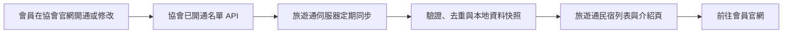

# 協會官網開通旅遊通後自動刊登會員民宿：API 串接規劃

本文件是完整串接規劃。2026-11-13 已依使用者授權完成第一階段本機 API 讀取、同步預覽與去重，詳見[實作與驗證](./association-member-api-implementation.md)；正式匯入仍固定停用，未部署。最終目標是會員只在協會官網維護資料、開通旅遊通，旅遊通就自動出現民宿介紹與「前往官網」連結；後續修改及關閉也會同步。

## 1. 信件與現況證據

- 理事長 2026-11-11 15:13（Asia/Taipei）來信，主旨「官網與旅遊通會員民宿 API」。[使用者提供原信](https://mail.google.com/mail/u/0/#all/FMfcgzQjgqPzRKCrzRMsVsqMGTxfzkdH)；Gmail 讀取的訊息 ID 為 `1a1c974eee450811`。
- 信件提供 `GET https://ythma.com/api/bnb/`，認證使用 `X-Api-Key`。金鑰不收入本文件、證據檔、前端或 Git。
- 2026-11-13 台灣時間唯讀測試：HTTP 200，`ok=true`、`count=83`，`data` 實際 83 筆，來源 `generated_at=2026-11-13T00:29:27+08:00`。
- 回應根欄位：`ok, count, generated_at, data`。每筆欄位：`id, name, area, phone, website, line, line_url, email, owner_name, photos, updated_at`。
- 83 個來源 ID 都唯一、都是 22 字元字串。`photos` 為 `{url, thumb}[]`，共 133 張，1 家沒有照片；照片 URL 主機均為 `ythma.com`。只抽查 1 張 HEAD，HTTP 200、image/jpeg，不能視為全部照片可用。
- 旅遊通公開 `GET /api/fetchBnbs?limit=100` 回傳 46 筆。與協會快照相比，名稱相符候選 30 筆、網址相符候選 28 筆，兩者聯集 38 筆；其中名稱與網址都唯一指向同一既有項目的候選 20 筆。這是初步配對，並非已確認可合併。
- 既有環境設定所指民宿 DB，於 READ ONLY transaction 查得 55 筆、公開條件符合 46 筆；`homestays.id` 是 varchar(10)，`email`、`password_hash` 為 NOT NULL，email 另有唯一限制。公開筆數與正式 API 相符，但本次未從雲端管理端另核部署環境與 DB 分支。
- 本次來源樣本沒有旅遊通開通布林值、完整地址、經緯度、價格、房況、會員資格有效期、刪除事件或分頁欄位。
- 聚合證據：[association-member-api-inspection-20261113.json](./evidence/association-member-api-inspection-20261113.json)。不保存會員完整回應、負責人或 Email。

**2026-11-13 使用者確認：**可以依 API 名單同步。此名單目前沒有獨立開通欄位，實作按使用者選定的名單處理；已完成固定 ID 對照與待確認清單，疑似重複不直接匯入。完整名單、永久 ID、取消刊登及重新開通的供應端行為仍須驗證，正式匯入尚未開放。

## 2. 會員與旅客流程

1. 會員登入協會官網，填妥民宿名稱、區域、官網、電話／LINE、照片。
2. 開啟「刊登到宜蘭旅遊通」，顯示公開欄位說明並記錄同意時間；不再要求會員到旅遊通重新註冊。
3. 旅遊通後端定期取得已開通名單，自動新增或更新民宿卡片及詳情頁。
4. 旅客在旅遊通看照片、搜尋區域，點「前往官網」到會員的網站；不嵌入對方整個網站。
5. 會員仍回協會官網改基本資料；旅遊通既有價格、房況、特色等進階資料沿用原管理流程。
6. 會員關閉開通後，旅遊通停止曝光；重新開通使用相同資料關係與網址。

會員端建議文字：「開通後，民宿名稱、區域、電話、LINE、官網及照片將同步刊登於宜蘭旅遊通。資料更新可能需數分鐘。」官網未有回報 API 前，不顯示虛構的「已同步成功」狀態。



## 3. 建議架構：單向同步、本地讀取

沿用本專案 Nuxt 3、Server API、Neon PostgreSQL、Bootstrap 5。

- 協會官網是會員基本資料與開通狀態的管理來源；旅遊通負責曝光與既有進階功能。
- 訪客只讀旅遊通本地資料，不直接從瀏覽器呼叫協會 API，也不取得 API key。
- 新增獨立來源表，保留現有民宿帳號及編號。來源 22 字元 ID 不塞入現有 varchar(10)，不截短、不轉數字，也不建立假 Email 或共用密碼。
- 透過共用公開查詢層整合來源表與既有 `homestays`，先合併／去重再套用搜尋、排序、計數、分頁。各公開入口使用同一組曝光條件。
- 輪詢為第一版；官網日後增加 webhook 可縮短延遲，定期全量核對仍保留。

建議正常情況每 5 分鐘同步一次，公開快取最多再 60 秒，驗收目標約 6 分鐘內反映。這是設計目標，必須連同來源新鮮度、排程和快取一起驗證，不是現況承諾。

現有 `vercel.json` 只有每日活動匯入排程。Vercel 官方文件目前列出 Hobby Cron 最短一天一次、Pro／Enterprise 最短一分鐘；本次未確認帳戶方案。因此每 5 分鐘排程須使用支援頻率的現有方案，或官網端排程／其他已授權的伺服器排程。未確認前不新增費用或承諾準即時同步。[Vercel 官方限制](https://vercel.com/docs/schedules/cron-jobs/usage-and-pricing)

## 4. 資料表與既有會員配對

### 建議新增

| 表 | 用途與主要欄位 |
|---|---|
| `association_homestays` | `source`、`external_id text`、`name`、`area`、`website`、`phone`、`line_url`、`photos jsonb`、`source_updated_at timestamptz`、`last_seen_at`、`source_state`、`missing_since`、`missing_runs`、`content_hash`。唯一鍵 `(source, external_id)`。僅存白名單公開資料。 |
| `association_homestay_links` | 來源唯一鍵、`homestay_id varchar(10)` 外鍵、`match_state`、人工確認時間／操作 ID、必要的逐欄位本地覆寫。來源一對一；同一來源不得重複連到同一既有民宿。 |
| `association_sync_runs` | run ID、開始／結束、來源產生時間、成功／失敗、完整性狀態、筆數與新增／更新／待配對／隱藏數、公開資料版號、淨化後錯誤碼。 |
| `association_listing_overrides` | 管理員暫停曝光、原因與到期時間；同步不得繞過管理員停用。亦可併入來源表，實作時擇一。 |

來源狀態至少有 `active`、`missing_pending`、`inactive`、`quarantined`。配對狀態獨立表示 `new`、`review_required`、`linked`，避免把「找不到舊會員」誤當「停用」。

### 首次匯入

- 先產生 dry-run 差異表，涵蓋全部 55 筆既有記錄，包括未公開與被退回的項目；本次 38 筆候選僅基於公開 46 筆。
- 以正規化官網完整識別、名稱、區域、公開電話交叉配對。共用訂房平台或同集團網域不能只按 hostname 合併；網址路徑與有意義查詢參數要保留。
- 20 筆雙條件候選優先人工確認；其他衝突進管理員待配對清單，不讓一般會員重複填表。
- 已有對照者保持既有 `/homestays/{id}` 與帳號；來源基本資料覆蓋的是公開呈現層，不覆寫舊帳號資料、價格或房況。
- 確認為新民宿者使用來源命名空間 public ID，例如 `ythma_{external_id}`，沿用 `/homestays/{public_id}` 路由並安全編碼。來源 key 不作登入帳號。
- 後續新的模糊配對只暫緩該筆，既有已確認配對繼續自動同步。
- 若已刊登的新來源頁日後連到舊頁，保留別名並 301 到原有 canonical，避免斷連結與重複 SEO。

### 公開欄位與管理權

| 協會 API | 旅遊通呈現 | 規則 |
|---|---|---|
| `id` | 來源識別與配對 | 需確認永久且不重複使用，與旅遊通既有 ID 分離 |
| `name` | 民宿名稱 | 來源管理；文字跳脫 |
| `area` | 鄉鎮篩選／所在地 | 不當完整地址，不填成街道地址 |
| `website` | 前往官網 | 驗證 HTTP(S)、拒絕 script/data/file 與含帳密 URL；外連使用安全 rel |
| `phone` | 公開電話 | 用於聯絡及配對，不搬入住客或私人聯絡資料 |
| `line_url` | LINE 聯絡按鈕 | 優先使用完整合法網址；不要直接把 `line` ID 放入 href |
| `photos[].url/thumb` | 相簿／縮圖 | 保留順序；空照片用預設圖；失效照片顯示替代圖。圖片使用權與允許熱連結由官網端確認 |
| `updated_at` | 同步版本比較 | 當來源時間解析，不拿同步時間冒充修改時間 |
| `email, owner_name` | 不公開、不匯入第一版 | 與民宿曝光目標無關，不回傳到前端或寫原始 payload 日誌 |
| API 沒有的欄位 | 保留既有資料／新資料空白 | 價格、特色、評價、地址、經緯度、房況、瀏覽數不推測、不覆寫 |

已配對的公開基本欄位由官網管理，旅遊通業者編輯頁對這些欄位改為唯讀並提供返回官網入口；不能讓使用者修改後表面成功、隔天又被同步覆蓋。本地特殊覆寫只給管理員，保留原因與解除方式。

來源新民宿沒有價格／評價時顯示「請洽民宿」／不顯示評分，不能沿用資料表 4.5 預設值當真實評價。沒有座標先只出現在清單，不能推定全鄉鎮中心作為民宿位置；沒有房況資料則不出現在「指定日期有空房」結果。

## 5. API 與執行流程

### 已存在的協會 API

```http
GET https://ythma.com/api/bnb/
X-Api-Key: <僅伺服器持有的金鑰>
Accept: application/json
```

目前已觀察到 `ETag` 和 `Cache-Control: private, no-store`，但條件請求、分頁和增量查詢未驗證。第一版不能假設支援 `since`、`page` 或 `If-None-Match`，也不能把無資料的 304 當成空名單。

### 旅遊通擬新增的內部接口

| 接口 | 行為與權限 |
|---|---|
| `POST /api/admin/association-sync/preview` | 現有管理員驗證；讀來源並回傳白名單差異，不套用資料 |
| `POST /api/admin/association-sync/run` | 管理員啟動同步；使用伺服器端來源設定，不接受任意遠端 URL |
| `GET /api/admin/association-sync/status` | 管理員查看最近成功時間、錯誤、待配對與可能下架項目 |
| `GET /api/cron/association-sync` | 沿用排程 Bearer secret 模式，`Cache-Control: no-store`，未啟用時直接跳過 |
| `POST /api/integrations/ythma/events` | 第二階段選配，需官網共同實作簽章、事件 ID 與時間戳；第一版不假設已存在 |

伺服器環境變數建議：`YTHMA_BNB_API_URL`、`YTHMA_BNB_API_KEY`、`ASSOCIATION_SYNC_ENABLED`、`ASSOCIATION_SYNC_DRY_RUN`。Secret 僅存在部署端秘密設定，範例檔只留名稱及占位文字。

### 同步步驟

1. 驗證排程／管理員身分；確認功能旗標；同一來源只允許一個同步流程。
2. 只向固定可信 HTTPS 主機取資料，禁止把金鑰帶往跨站轉址；設 timeout、回應大小上限、退避重試及 429 處理。
3. 驗證 HTTP、JSON、`ok`、`count`、唯一 ID、欄位型別、有效時間及全量完整性契約；完整 staging 成功後才可套用。格式不合法時保留最後有效資料。
4. 將公開欄位正規化並計算 hash，按 `(source, external_id)` upsert。相同版本重跑不得新增重複項目；排除舊快照覆蓋新版本。
5. 以 DB transaction 及來源鎖套用整批變更與新的公開資料版號；失敗 rollback。網路 fetch 不長時間佔用 DB transaction，寫入前再確認版本與鎖。
6. commit 後所有公開讀取以資料版號作快取鍵或統一失效。現有 `fetchBnbs.js` 的程序內 Map TTL 為 5 分鐘，不能只清除執行同步的單一 instance 就宣稱全站即時更新。
7. 記錄聚合結果，失敗在後台顯示最後成功時間。連續 3 次失敗或超過 20 分鐘未更新先列為運維異常（以 5 分鐘排程為前提）；外部訊息通知管道另行設定，不自行寄信。

## 6. 停用、來源故障與資料保護

- 第一版只有 active 名單，沒有明確停用事件。只有在官網確認「完整名單缺席就表示取消刊登」後，才啟用依缺席自動隱藏。
- 建議以 2 次完整成功快照均缺席、間隔至少 5 分鐘，作為暫停曝光條件；保留來源列與對照，重開時復用。正常目標約 11 分鐘內隱藏，含一分鐘公開快取。
- API 401／403／429／5xx、逾時、非 JSON、count 不符、異常格式、過期快照均不得當成全部停用。
- 單次變成 0 筆，或相較最近可信完整快照減少超過 20%，暫停「依缺席隱藏」，交由管理員確認；這是待調整的營運保護門檻，後台必須顯示可能延後下架的異常。
- 明確驗證的會員關閉事件／管理員緊急下架可立即隱藏，不受全量缺席保護延遲；目前尚無此事件 API。
- 只影響已納入協會來源管理的項目。沒有配對的本地民宿不因未出現在協會 API 被整批移除。
- 對已被旅遊通管理員拒絕、停用的既有項目，不得藉新來源 ID 重新公開。
- 曝光狀態與既有登入、房況、交易資料分開保存；回復部署或停止同步不應刪除帳號或歷史資料。
- 正式切換前留下公開資料快照／對照備份與回復步驟；回復時保留關閉刊登的抑制清單，避免因切回舊清單把已取消者重新公開。

## 7. 實作範圍

| 區域 | 預計工作 |
|---|---|
| 資料層 | 新增來源、配對、執行紀錄 migration；共用查詢層／view 與來源連線 adapter |
| 匯入服務 | `server/services/association-sync.js`，獨立於活動匯入，支援 dry-run、鎖、版本、完整性保護 |
| 管理端 | 來源狀態、配對衝突、手動同步／預覽與本地停用；沿用 admin layout 和設計 token |
| 公開列表／詳情 | `server/api/fetchBnbs.js`、`fetchBnbDetail.js`、`pages/homestay-list.vue`、`pages/homestays/[id].vue`；官網按鈕、圖片缺值、來源 ID、去重與快取 |
| 其他公開入口 | `homestay-map-data.get.js`、`site-stats.get.js`、sitemap、兩種 llms 路由及 SEO 輸出採同一曝光條件 |
| 會員編輯 | `pages/homestay-admin.vue` 和 `update-homestay.post.js` 控制來源管理欄位；保留既有帳號功能 |
| 房況搜尋 | 無房況的來源新民宿不當作有房；已配對者依原有 homestay ID 查詢 |
| 設定與排程 | 私有 runtime config、環境變數範本、可支援目標頻率的排程與監測 |

目前已完成來源 adapter、預覽、持久化待確認清單、人工固定 ID 對照、一對一資料庫限制及匯入鎖定；已保存 83 筆候選，沒有自動確認配對。公開匯入、公開頁整合與排程留待後續實作。詳見[實作與驗證](./association-member-api-implementation.md)。

## 8. 驗收與交付順序

1. **確認契約**：開通條件、ID 穩定性、完整名單／分頁、停用含義、頻率限制、照片授權。用測試會員實際開／關，確認 API 是否新增／移除；只看 200 回應不算完成。
2. **完成預演**：比對 83 筆來源和全部本地會員，列出新增、更新、疑似同店、待配對、會隱藏數量；首次不套用。
3. **測試環境實作**：使用合成資料測試開通、修改、關閉、重開；相同批次重跑、併發、舊版本、欄位缺漏、來源驟減、API 故障。
4. **小量試跑**：涵蓋 1 筆新民宿、1 筆已配對舊民宿、1 筆無照片資料；核對官網與 LINE 可點、Email／負責人未外洩、無重複卡片、原價格房況不變。
5. **端到端驗收**：清單、詳情、地圖（有座標者）、站內統計、sitemap／llms、手機外連；量測從會員儲存到公開可見的真實延遲及停止曝光。
6. **正式切換**：處理初始配對，部署並啟用排程；觀察至少兩次自然排程與一次真實設定變更，才可宣稱自動串接完成。

粗估：旅遊通端實作、配對介面和驗收 2–4 個工作天；首次人工配對依衝突量另計。官網改動、取得契約答覆、排程方案或 webhook 不含在這個估算，也不是已排定工期。

## 9. 給官網維護者的確認文字（未寄送）

> 旅遊通已測試會員民宿 API 可讀，目前回傳 83 筆。我們準備做成會員在協會官網開通後，自動出現在旅遊通並連回會員自己的官網。請協助確認：
>
> 1. 目前依 API 名單作為同步來源；請說明會員進入／退出此名單的條件，以便核對取消及重新開通行為。
> 2. id 是否永久固定、不會重複使用？回傳是否為完整名單，有沒有分頁或筆數上限？
> 3. 會員關閉旅遊通、退會或停權後，資料會從 API 移除嗎？多久反映？能否提供明確狀態／停用事件？
> 4. 是否允許每 5 分鐘讀取？是否支援更新通知 webhook？
> 5. API 內照片能否在旅遊通公開使用與熱連結？目前不公開 Email 和負責人。
>
> 我們會保留旅遊通現有民宿網址、帳號和進階資料，先建立對照，避免重複刊登。

## 10. 查核來源與限制

- 信件文字與指定會員 API：本次直接讀取；未保存金鑰及完整會員 payload，未寄出回信。
- 現況程式：`server/api/fetchBnbs.js`、`fetchBnbDetail.js`、`homestay-register.post.js`、`homestay-login.post.js`、`update-homestay.post.js`、`homestay-map-data.get.js`、`server/api/cron/activity-import.get.js`、`vercel.json`。
- 官網公開角色與站點：[宜蘭觀光民宿行銷協會](https://ythma.com/)；API 的未公開契約不能從官網首頁推定。
- 只觀察一個來源名單快照，不能據此證明所有開通／取消行為、永久 ID、來源完整性及可靠度。沒有操作會員開關，沒有變更正式會員資料。
